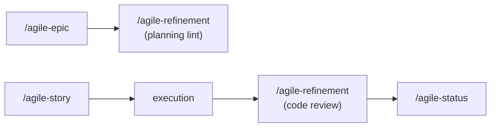

# Refinement

Use this skill to validate planning artifacts and review code quality. It operates in two modes: planning lint and code review.

Initial context received via slash: $ARGUMENTS

If `$ARGUMENTS` is filled (e.g., file path, branch, "planning", "code"), use as starting point to determine mode.
If empty, ask the user what they want to validate: planning artifacts or code changes.

## Language

Write any report output in the user's language. Apply correct grammar and any required diacritics or script-specific characters. If the user's language is unclear, ask before generating output.

## Project root

This skill writes artifacts at paths relative to the **project root** (the repo where the work happens), not the agent's current working directory.

- If invoked from inside the project, use the relative paths shown in this skill.
- If invoked from another directory (e.g., a sibling repo, or when the project lives elsewhere), prepend `<project-root>/` to every artifact path.
- When the project root is ambiguous, confirm with the user via the harness question tool before writing.

## Prompting

Follow the project-wide convention in `CLAUDE.md` / `AGENTS.md` ("Skill Prompting Conventions"). Use the harness's structured-question tool — `AskUserQuestion` (Claude Code), `ask_user_question` (Codex), or `question` (OpenCode) — for the decision points below. Use free-form text only where a path/name/value cannot be enumerated.

| Decision point | Why structured | Suggested options |
|---|---|---|
| Target | Branches the workflow | Planning artifact · Code · Both |
| Depth | Affects review effort | Lint-only · Full review · Security focus |
| Who reviews (code review) | Independence of the verdict | Fresh session or another agent (recommended) · Teammate · This session (flagged as self-review) |

Free-form prompts (no structured tool):

- File paths to review
- Specific concerns

No-pause mode: if the user has explicitly disabled mid-skill clarification, or nobody can be asked (delegated, non-interactive run), or the skill runs as a delegated, non-interactive agent with nobody to ask, apply the recommended option for every structured prompt, record it under *Open questions* (or equivalent), and proceed without blocking.

## Objective

- Validate planning artifacts for consistency, completeness, and correctness
- Review code changes for security, coherence, scope, and quality
- Catch issues before they become problems in execution
- Provide actionable, specific feedback — not generic observations

## When to use

- Before starting implementation — lint the planning artifacts
- Before committing code — review the diff
- When opening a pull request — quality gate
- When reviewing AI-generated code — human-equivalent review
- Periodically — check for stale content, broken cross-references, or orphaned artifacts
- When merging or completing an epic — validate all pieces fit together

## When NOT to use

- Creating planning artifacts — use `/agile-intake`, `/agile-epic`, `/agile-story`, `/agile-roadmap`
- Decomposing work into stories — use `/agile-epic` (which now handles decomposition)
- Tracking delivery progress — use `/agile-status`
- Planning a sprint — use `/agile-sprint`

## Mode 1: Planning Lint

Validates planning artifacts against the following checks:

### Cross-references
- [ ] Origin fields point to existing files
- [ ] Referenced epics, stories, and tasks exist
- [ ] File paths in cross-references are correct and files are present

### Dependencies
- [ ] Declared dependencies between stories/tasks exist
- [ ] No circular dependencies
- [ ] Dependency order is consistent with the roadmap/epic sequence

### Completeness
- [ ] Required sections are present (for stories, the list in `/agile-story` → "Required sections")
- [ ] No empty required fields
- [ ] Acceptance criteria are defined and verifiable
- [ ] Tasks are specific and actionable (not vague)

### Product traceability
- [ ] UI-heavy epics/stories reference prototype routes/screens when prototypes exist
- [ ] Domain behavior references `business/*.md` rule IDs/files when business rules exist
- [ ] Prototypes do not carry internal implementation or business-rule explanations as visible product copy
- [ ] Business rules discovered during prototype review were captured outside the prototype
- [ ] No raw secrets, provider keys, tokens, or credentials appear in planning artifacts

### Consistency
- [ ] Sizing is consistent across related artifacts (stories within an epic)
- [ ] Status fields are up to date
- [ ] Naming conventions match across files

### Format
- [ ] File naming follows convention (`00-overview.md`, `NN-story-name.md`)
- [ ] Folder structure follows convention (`planning/<initiative>/epics/NN-<epic>/`)
- [ ] Templates are properly filled (no leftover placeholder text)

### Scope conflicts
- [ ] No overlapping scope between stories in the same epic
- [ ] Out-of-scope items are not referenced as tasks

### Stale content
- [ ] No artifacts with all tasks completed but status still "in progress"
- [ ] No referenced files that have been deleted or moved
- [ ] No plans older than 30 days with incomplete tasks and no recent daily

### Process

1. Identify the scope: a single file, an epic folder, or the entire `planning/` tree.
2. Read all artifacts in scope.
3. Run each check category above.
4. Produce an inline report grouped by category with specific issues and locations.

## Mode 2: Code Review

Reviews a change with the checklist in `references/code-review.md` (correctness, security, tests, coherence, scope, completeness).

### Independence

The author's own self-check is not a review. The review is done by someone without the author's working context: a fresh agent session, another agent, or a person. When this skill runs in the same session that wrote the code, say so in the report and recommend an independent pass before merge. Give the reviewer the code and the acceptance criteria, not the author's conclusions.

### Process

1. Identify the scope and pin it: base and head commits. Review `git diff <base>...<head>` (or the PR diff), never a commit range that includes merges from the base branch; after a merge, `git diff <merge>^1 <merge>^2`.
2. Read the complete diff and the story's acceptance criteria before issuing any output.
3. Apply each checklist category.
4. Report findings, each with severity, `file:line`, and a concrete failure scenario (input or state → wrong result). No finding without a scenario. Severity:
   - `blocker` — a security issue, a correctness bug inside the story's scope, or an acceptance criterion without proof;
   - `minor` — everything else worth fixing (style of a test, missing docs, small refactor).
5. Give a verdict:
   - `ok` — no open blocker;
   - `changes` — at least one blocker is open;
   - `blocked` — cannot be reviewed as is (missing context, broken build, scope far beyond the plan).

### Closing the loop

- The author answers **every** finding: `fixed` (with the change), `declined: <reason>`, or `backlog: <item>` for minors outside the scope. An unanswered finding is a silent decision.
- Minors never hold the verdict once answered. A declined blocker goes back to the reviewer, who either accepts the reason (verdict `ok`) or keeps `changes` and says why.
- A verdict is valid for the code it reviewed. If code changes afterwards, re-review what the change touched; commits that only touch planning or status files (checkboxes, closure reports) do not invalidate it.
- Merge needs verdict `ok` on the final code plus the applicable validation items in PASS (or N/A with reason).
- After three review rounds without reaching `ok`, or if the change grew well beyond its plan, stop and reassess: split the work or narrow the scope, and record the decision.

## Output

The report is inline by default. When a closure or a pull request will cite the review, save it where the team keeps reviews (a PR comment, or `planning/<initiative>/reviews/<slug>.md`) with the commit, verdict, findings, and their responses. The report contains:
- Issues grouped by category
- Severity: `blocker` or `minor` for code review; for planning lint, red flag (reject), warning (fix before proceeding), info (consider)
- Specific file and line references, with a failure scenario for code findings
- Actionable suggestions for each issue
- In code-review mode: the commit reviewed and the verdict (`ok`, `changes`, `blocked`)

## Rules

- Read everything in scope before producing any output.
- Be specific. "Code looks bad" is not actionable. "Replace `RateLimitError` with `HttpError` on line 42 of `src/middleware/rate-limit.ts`" is.
- A review by the author's own session does not count as the independent review; say so when that is the case.
- Planning lint can be run at any time — it's a health check, not a ceremony.
- Never produce vague, generic feedback. Every issue must be verifiable.

## Relationship with the flow

This skill validates artifacts and code at any point in the flow. For creating planning artifacts, use `/agile-epic` or `/agile-story`. For tracking delivery, use `/agile-status`.
