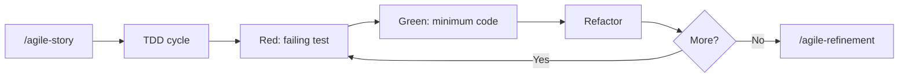

# TDD (Test-Driven Development)

Guide the Red-Green-Refactor cycle and pragmatic testing strategy. "Write tests. Not too many. Mostly integration."

Initial context received via slash: $ARGUMENTS

If `$ARGUMENTS` is filled (e.g., module name, feature description), use as starting point.
If empty, ask what will be tested.

## Language

Write artifacts and test descriptions in the user's language. When in doubt, ask. Test code itself (function names, assertions) stays in English.

## Project root

This skill writes artifacts at paths relative to the **project root** (the repo where the work happens), not the agent's current working directory.

- If invoked from inside the project, use the relative paths shown in this skill.
- If invoked from another directory (e.g., a sibling repo, or when the project lives elsewhere), prepend `<project-root>/` to every artifact path.
- When the project root is ambiguous, confirm with the user via the harness question tool before writing.

## Prompting

Follow the project-wide convention in `CLAUDE.md` / `AGENTS.md` ("Skill Prompting Conventions"). Use the harness's structured-question tool — `AskUserQuestion` (Claude Code), `ask_user_question` (Codex), or `question` (OpenCode) — for the decision points below. Use free-form text only where a path/name/value cannot be enumerated.

| Decision point | Why structured | Suggested options |
|---|---|---|
| Enforcement mode (when installing) | Hard-to-undo policy choice | warn · block · keep current |
| Test strategy (when ambiguous) | Affects file layout | sibling · sibling_dir · tests_root |
| Exempt a specific path | Edits guardrails config | yes · no · review later |
| No validation contract found | Creates a project-level file | create `VALIDATION.md` from the template · use an existing equivalent (name it) · skip for now |

Free-form prompts (no structured tool):

- Test descriptions
- Exemption rationale

No-pause mode: if the user has explicitly disabled mid-skill clarification, or nobody can be asked (delegated, non-interactive run), or the skill runs as a delegated, non-interactive agent with nobody to ask, apply the recommended option for every structured prompt, record it under *Open questions* (or equivalent), and proceed without blocking.

## When to use

- Starting a new feature with TDD
- Adding tests to existing code
- Establishing test coverage for a module
- Creating or updating the project's validation contract (`VALIDATION.md`)
- Unclear whether something needs unit, integration, or E2E tests

## When NOT to use

- Quick prototypes where tests add no value -- use `/agile-proto`
- Throwaway scripts
- Pure documentation changes in a project whose product is code (docs-first packages still get a contract: see archetype 5 in `references/by-project-type.md`)

## TDD cycle

1. **Red** -- write a failing test that describes the desired behavior
2. **Green** -- write the minimum code to make it pass
3. **Refactor** -- improve structure without changing behavior
4. Repeat

Present each step explicitly. Do not skip Red -- the test must fail first.

## Validation contract

Each project keeps one contract of what must be proven before a change is done: `VALIDATION.md` at the root, or an equivalent the team already uses (a CONTRIBUTING section, a CI policy doc). It lists the test layers with the command that runs each, the per-change checks, and the manual checks.

- Look for it first. If none exists, offer to create it from `templates/validation.md`:
  1. read the package scripts and every CI workflow step;
  2. write one layer row per check, with its command and any flag that makes it strict (for example an env var that turns skips into failures);
  3. mark each row `per change` or `release`, choosing layers with `references/by-project-type.md`;
  4. write the per-change checks in the project's own terms (screens, endpoints, commands, documents).
- Every item ends in **PASS, FAIL, NOT RUN, BLOCKED**, or **N/A** with the reason. Not proven is never PASS. A change is done only when every applicable per-change item is PASS (or N/A) on the final code; otherwise it is partial. Layers marked as release gates are reported at release, not per change.
- `/agile-story` copies its Verification items from the contract; `/agile-status` (closure) reports one verdict per item.

## Choosing test layers

Pick layers by project type, not by fixed percentages: `references/by-project-type.md` maps pure logic, backend/boundary, UI, and concurrent/desktop/CLI code to the techniques that pay off. Diversity of test types finds more bugs than more tests of one type.

Coverage is a signal, not the goal. Use it to find untested critical code; a project's coverage floors, if it has them, live in its contract and CI. A line covered by a test that would still pass with the code broken proves nothing.

When a project keeps business rules in `planning/<initiative>/business/*.md`, use those rule IDs to decide what deserves tests. Tests should prove behavior behind important rules, not restate the rule text.

## Accepted tests

A test earns its place when it verifies **observable behavior**: a result the user sees, or a contract another component relies on.

Every new test falls in one category: regression of a real bug (name the symptom), domain rule, property or invariant, API contract, integration with a real dependency, critical flow, security or permission boundary, concurrency or idempotency.

**Name the mutation the test kills, and try it.** Write which code change would make the test fail (for example, dropping a validation, `>` becoming `>=`, ignoring a scoping key) and confirm it fails when you make that change. If no mutation can be named, the test protects nothing: delete it. Where it pays (critical pure logic, boundaries), run a mutation tool (Stryker, mutmut, cargo-mutants, PIT) on that module.

Reject and delete:

- "x is defined" with no assertion on shape or behavior;
- "foo was called" without checking the effect;
- "the component renders" with no DOM or contract assertion;
- snapshots over ~30 lines without a comment naming the rule they protect;
- mocking the unit under test.

Hard to set up is a signal to refactor (extract a smaller child or a pure function with injected dependencies), not to skip the test.

## Conventions

Follow the project's existing conventions for test location, naming (`.test` vs `.spec`), runner, and test data (factories, fixtures, builders). When the project has none, a sensible default is unit tests beside the source (`foo.test.ts`) and integration/E2E under `tests/`.

- Arrange / Act / Assert; one concept per test; names that read as sentences.
- No shared state between tests; no order dependence.
- No arbitrary `sleep(ms)`: wait for the condition.
- Test through the public API, not private methods.
- Mock external dependencies, not your own code.

## Commands (Bun)

```
bun test
bun test --watch
bun test --coverage
bun test --filter "name"
bun test src/dir/
```

Adjust for other runtimes (vitest, jest) as needed. Detect the project's test runner from `package.json` or config files before suggesting commands.

## Process

### 1. Understand what to test

Explore the code to understand:
- What module or feature needs tests
- What behaviors are critical
- What is already covered (check existing tests)
- Which business rule IDs, acceptance criteria, or prototype flows the change must satisfy

For front-end work, discover every prototype source that actually exists before starting Red. A project may have an Agile-Proto browser prototype, an Agile-Design prototype in a design tool, both, or neither. Prototype evidence improves component selection and clarifies observable behavior; it never grants or withholds permission to implement.

Read `references/prototype-sources.md` for how to read Agile-Proto and Agile-Design sources and combine them when both exist.

Never refuse implementation solely because a prototype is absent, incomplete, stale, or represented in more than one format. Use every available signal and proceed with the best supported component choice.

TDD still decides observable behavior: test the screen flow, validation, permissions, state changes, and integration contracts rather than the internal markup of a design-system component.

### 2. Choose the right test type

Use the project's contract and `references/by-project-type.md` as guide:
- Pure function with no side effects? Unit test.
- Service that talks to DB or external API? Integration test.
- Critical user flow that spans multiple systems? E2E test.
- Front-end behavior with validation, API contract, permission, optimistic update, or offline/sync state? Integration test.
- Static copy, simple rendering, or visual-only detail with no rule? Usually no test unless it protects a known regression.

For local-first products, give priority to tests that cover command validation, optimistic state, offline queue persistence, reconciliation, conflict handling, permissions, and audit events.

### 3. Execute the TDD cycle

For each behavior:
1. Write the failing test (Red)
2. Implement the minimum code (Green)
3. Refactor if needed
4. Verify the test still passes

Record the business rule ID or acceptance criterion in the test description or surrounding story artifact when that mapping helps future refinement. Record the mutation each new test kills next to it.

### 4. Verify against the contract

Run the layers the contract requires for this change. During iteration run only the suite that proves the current item; run the full set once, on the final code, before reporting. Report real results with counts, and say what was proven and no more: "no regression observed in <suites>", never "zero regressions". Use coverage to find untested critical paths, not as the finish line.

## Chaining

- During feature implementation: work inside the `/agile-story` checklist
- After implementation: `/agile-refinement` to review test quality
- Before closing: ensure tests are part of `/agile-status` (closure mode) verification
- If the TDD workflow exposes repeated friction, missing guidance, weak templates, or unclear verification, capture a concise skill feedback note with the affected skill/template, evidence, proposed change, and validation artifact.
- If repeated TDD friction suggests a skill/template change, draft a proposal for human review before editing the process library.

## Enforcement (optional, opt-in per project)

This skill ships hook templates that turn the TDD rule into a project-level guardrail: a pre-write hook warns or blocks when a source file in `source_paths` has no companion test, a Stop hook audits the session diff, and a SessionStart hook announces the rule. Project-type templates (`templates/project-types/<type>/`) add type-specific evidence, such as the `tauri` build and screenshot checks.

The hooks check file-pair existence only: not Red-before-Green order, not that the test exercises the source, not that it passes. Semantic discipline stays with the agent.

- Installing, configuring (`.tdd-guardrails.yml`), harness matrix, project types, and bypassing: `references/enforcement.md`.
- Tauri validation flow, gotchas, and Definition of Done: `references/tauri.md`.

## Relationship with the flow



This skill operates during execution. It pairs with `/agile-story` (which defines what to build) and feeds into `/agile-refinement` (which validates the result). When the optional enforcement is installed, the rule is also applied automatically at every `Write/Edit/MultiEdit` tool call.
